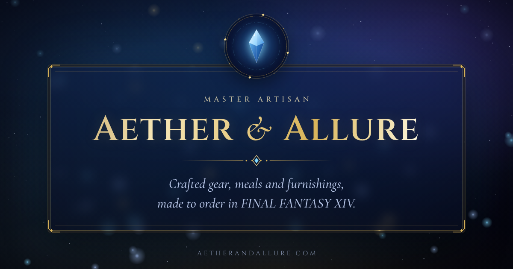

# Aether & Allure

The website for **Aether & Allure**, Sigrid Halvorsen's crafting shop in
FINAL FANTASY XIV, at [aetherandallure.com](https://aetherandallure.com).
It's written in Rust and compiled to WebAssembly with [Leptos](https://leptos.dev),
built with [Trunk](https://trunkrs.dev), and runs in a Docker container on your
own server. The code is kept on GitHub.

© 2026 Jason Telford. The code is released under the
[BSD 3-Clause License](LICENSE); the logos, artwork and branding are not (see
[License and credits](#license-and-credits)).

## Documentation

How to edit the shop, work on the site and run it on your server is in the
[wiki][wiki].

### The shop

- [Editing the shop][]: what each part of [`shop.toml`](shop.toml) controls
- [Adding items][]: looking items up, and setting prices from the market board, with shop-tools
- [Settings and secrets][]: `.env`, your Discord name and email, and secrets
- [Item links and icons][]: Eorzea Database links, tooltips and icons
- [Visitor orders][]: how a visitor's order is kept in their browser

### Working on the site

- [Developing in the dev container][]: working in Zed, with every tool in a container
- [Running it without the container][]: installing Rust and Trunk yourself
- [Making changes][]: branches, pull requests and merging into `main`
- [Build check][]: the check GitHub runs on every pull request into `main`
- [Your own main branch][]: the git hook that guards `main` on your computer

### The server

- [Hosting on your server][]: what the server needs, and the first deploy
- [Updating the site][]: putting merged changes live

### Reference

- [Site design][]: the look, fonts, logo, icons, hero and intro, the pages and the navigation
- [Assets][]: where the site's files live, and where the build puts them
- [Project layout][]: what each file and folder is for
- [License and credits][]: which licence covers the code, the art and branding, the fonts and the game material

## License and credits

© 2026 Jason Telford. The [BSD 3-Clause License](LICENSE) covers the software
only. [`NOTICE.md`](NOTICE.md) lists what falls under each of these:

| Material | Terms |
| --- | --- |
| Rust application code | BSD 3-Clause License |
| JavaScript and development tools | BSD 3-Clause License |
| CSS implementation | BSD 3-Clause License |
| Original logos and artwork | All rights reserved |
| Original branding and visual identity | All rights reserved |
| Third-party fonts: Cinzel, Cormorant Garamond and Alegreya Sans | Their own SIL Open Font License 1.1 (see [`assets/fonts`](assets/fonts)) |
| Third-party game data and assets | Their respective terms |

FINAL FANTASY XIV © SQUARE ENIX CO., LTD. All Rights Reserved. FINAL FANTASY is a
registered trademark of Square Enix Holdings Co., Ltd. This is an unofficial fan
site and isn't affiliated with or endorsed by Square Enix. The game material is
used under Square Enix's FINAL FANTASY XIV Materials Usage Policy
([Europe](https://support.eu.square-enix.com/rule.php?id=5383&la=2&tag=authc),
[North America](https://support.na.square-enix.com/rule.php?id=5382&la=1&tag=authc)).

[wiki]: https://github.com/jaygtel/ffxivshop/wiki
[Editing the shop]: https://github.com/jaygtel/ffxivshop/wiki/Editing-the-shop
[Adding items]: https://github.com/jaygtel/ffxivshop/wiki/Adding-items
[Settings and secrets]: https://github.com/jaygtel/ffxivshop/wiki/Settings-and-secrets
[Item links and icons]: https://github.com/jaygtel/ffxivshop/wiki/Item-links-and-icons
[Visitor orders]: https://github.com/jaygtel/ffxivshop/wiki/Visitor-orders
[Developing in the dev container]: https://github.com/jaygtel/ffxivshop/wiki/Developing-in-the-dev-container
[Running it without the container]: https://github.com/jaygtel/ffxivshop/wiki/Running-it-without-the-container
[Making changes]: https://github.com/jaygtel/ffxivshop/wiki/Making-changes
[Build check]: https://github.com/jaygtel/ffxivshop/wiki/Build-check
[Your own main branch]: https://github.com/jaygtel/ffxivshop/wiki/Your-own-main-branch
[Hosting on your server]: https://github.com/jaygtel/ffxivshop/wiki/Hosting-on-your-server
[Updating the site]: https://github.com/jaygtel/ffxivshop/wiki/Updating-the-site
[Site design]: https://github.com/jaygtel/ffxivshop/wiki/Site-design
[Assets]: https://github.com/jaygtel/ffxivshop/wiki/Assets
[Project layout]: https://github.com/jaygtel/ffxivshop/wiki/Project-layout
[License and credits]: https://github.com/jaygtel/ffxivshop/wiki/License-and-credits
